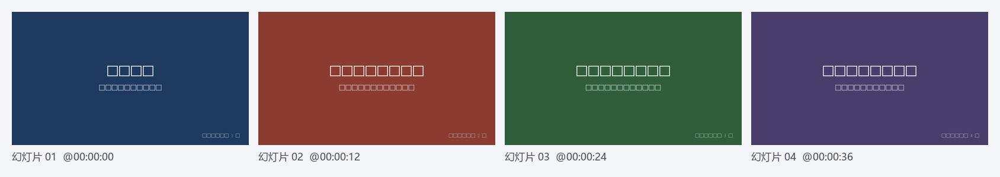

# lecture-notes · 录播笔记工具

把一段**本地的**网课 / 讲座录播，变成一套可以直接复习的资料：

| 产出 | 说明 |
|---|---|
| `幻灯片/` | 从录屏画面里按画面变化抽出来的课件截图（含 `index.json` 时间索引） |
| `逐字稿.txt` | 首行注明字幕来源，之后按句一行：`[HH:MM:SS] 发言人：文本` |
| `回看.html` | **单文件、离线、双击即用**的回看页：左边视频，右边跟着进度高亮逐字稿，点句子/点课件图就跳转 |
| `笔记.md` | 结构化笔记（大纲、知识点、易错点、复习清单、视频时间轴） |
| `笔记_图文版.md/.docx/.pdf` | 正文里按「讲解时间点 ↔ 课件帧」对齐插入截图的版本 |
| `元信息.txt` | 视频名、时长、抽帧数、幻灯片张数、字幕来源、OCR 是否启用、生成时间 |

字幕（逐字稿）可以自己给，也可以让**可选 ASR** 现场转写；课件文字可以用**可选 OCR** 识别出来，
写进 `幻灯片/index.json` 并参与抽帧去重。这两个都是**可选依赖，不装也能跑通**。

## 效果

演示素材由 `python make_demo.py` 现场合成（彩色画面 + 文字模拟 4 张幻灯片），跑一遍就有：


抽出来的课件帧，文件名带时间点，`幻灯片/index.json` 里是完整索引：


## 这个工具干什么

输入两样东西——**一个本地视频文件**、**一份本地逐字稿**（`.srt` / `.vtt` / `.txt`），全程只读本地文件，不联网抓取任何内容：

1. `ffprobe` 读时长；
2. 没有给 `-t` 字幕时，尝试可选 ASR（`faster-whisper`）现场转写；
3. `ffmpeg` 按固定间隔抽帧，`numpy + PIL` 按画面差异阈值去重，挑出「课件画面变化」的关键帧；装了可选 OCR 就再按文字相似度合并「同一页被切两次」的帧；
4. 逐字稿（和每张截图对应的时刻，装了 OCR 还会附上每页文字摘录）交给任意 OpenAI 兼容的大模型，整理成结构化笔记；
5. `md2docx` 把图文版排成 Word（本机有 LibreOffice 就顺手出一份 PDF）；
6. 生成 `回看.html`：单文件、零额外依赖、纯原生 JS，双击打开就能跟着视频看逐字稿。

## 为什么只做后半段

抓取部分不随仓库分发：不同平台、不同时期的取流方式差别很大，且涉及登录态与站点条款，不适合公开维护；因此本仓库只发布**离线、可解释、可复用**的后半段处理链路。

## 安装

```bash
pip install -r requirements.txt          # 基础依赖（只要这四样就能跑完整链路）
```

或者装成包，按需加可选能力：

```bash
pip install -e .                # 只有基础能力
pip install -e ".[asr]"         # + 自动语音识别（faster-whisper）
pip install -e ".[ocr]"         # + 课件截图 OCR（rapidocr-onnxruntime）
pip install -e ".[all]"         # 两个都要
```

| 可选依赖 | 装了什么能用 | 不装会怎样 |
|---|---|---|
| `faster-whisper>=1.0` | 不给 `-t` 时自动转写逐字稿 | 打印一行指引，课件截图与回看页照常产出，但**退出码 2** |
| `rapidocr-onnxruntime>=1.3` | 课件帧 OCR：`index.json` 里多一个 `text`，多一层文本去重，笔记提示词里附每页文字摘录 | 静默降级，`元信息.txt` 里写 `OCR：未安装` |

另外需要 **ffmpeg / ffprobe**（抽帧必需）。查找顺序：

1. 环境变量 `SHIKE_FFMPEG` / `SHIKE_FFPROBE`
2. 系统 `PATH`
3. 包内 `tools/ffmpeg/bin/ffmpeg.exe`（想做成免安装包时把二进制放这里）

导出 PDF 需要 **LibreOffice**（找不到就只出 docx，不报错）。

## 用法

```bash
# 基本用法（不给 -o 时输出到 ./输出/<视频名>/）
python lecture_notes.py 录播.mp4 -t 逐字稿.srt

# 指定标题和输出目录
python lecture_notes.py 录播.mp4 -t 逐字稿.vtt --title 第三讲　极限 -o 输出/第三讲

# 不给字幕，让可选 ASR 自己转写（需要 pip install faster-whisper）
python lecture_notes.py 录播.mp4 --asr-model small --lang zh

# 先造一段 demo 素材试跑（纯 ffmpeg 合成，不需要任何外部文件）
python make_demo.py
python lecture_notes.py demo/demo.mp4 -t demo/demo.srt --title 演示讲座 -o 输出测试
```

参数：

| 参数 | 说明 |
|---|---|
| `video` | 本地视频文件（mp4 / mkv / flv / mov 等 ffmpeg 能解的） |
| `-t, --transcript` | 本地逐字稿，`.srt` / `.vtt` / `.txt`；**可省略**，省略则尝试可选 ASR |
| `--title` | 标题，默认取视频文件名 |
| `-o, --out` | 输出目录，默认 `./输出/<视频名>/` |
| `--asr-model` | 可选 ASR 的模型大小：`tiny`/`base`/`small`/`medium`/`large-v3`，默认 `small`；也可以填**本地模型目录**离线用 |
| `--lang` | 可选 ASR 的语言，默认 `zh`（`auto` 交给模型判断） |
| `--asr-device` | 可选 ASR 的推理设备：`cpu`（默认）/ `cuda` / `auto`。默认 cpu 是因为 ctranslate2 的 `auto` 在「有 N 卡驱动但没装 cuBLAS」的机器上会挑中 CUDA，建模型能过、一开始转写就崩 |

### 退出码

多个问题同时命中时取优先级更高的：**1 > 3 > 2 > 0**。

| 退出码 | 含义 | 此时还产出了什么 |
|---|---|---|
| `0` | 一切正常 | 全套产物 |
| `1` | **输入不可用**：视频不存在、读不出时长（不是可读的视频）、找不到 ffmpeg | 通常什么都没有（先修输入） |
| `2` | **缺逐字稿**：没给 `-t`，且可选 ASR 用不上（没装 / 拿不到模型权重） | 课件截图、`回看.html`、`元信息.txt` 照常产出 |
| `3` | **产物不完整**：一张幻灯片都没抽到，或配了模型 key 但笔记 / docx 生成失败 | 其余产物照常产出，日志里会有 `!!` 说明 |

```bash
echo $?     # 看上一条命令的退出码（shell）；脚本结束时也会在日志里写明「退出码 N：…」
```

既没给 `-t`、又没装 `faster-whisper`（或装了但拿不到模型权重）时，会打印一行明确指引：
没装 → `pip install faster-whisper`（或用 `-t 字幕文件`）；装了但下载不到权重 →
联网后重跑，或用 `--asr-model <本地模型目录>` 离线跑。此时课件截图、回看页、元信息照常产出，
**退出码 2**；其它退出码见上面的表。

逐字稿三种格式都认：

```
# .srt / .vtt  —— 标准字幕块，自动取每句起始时间
1
00:00:05,000 --> 00:00:09,000
讲师：这一节我们讲三个要点。

# .txt  —— 三种写法混用也行
[00:00:05] 讲师：这一节我们讲三个要点。
00:00:18 第一个要点是基本概念。
这一行没有时间戳，会按顺序均匀分配到整段时长里。
```

## 输出说明

```
输出测试/
├── 幻灯片/                 关键帧截图，文件名带时刻（01_00-00-15.jpg）+ index.json（含每页 text）
├── 逐字稿.txt              首行 # 字幕来源：本地文件 / asr(faster-whisper/small)，之后按句一行
├── 回看.html               单文件回看页：视频 + 高亮跟随的逐字稿 + 课件图章节（离线可用）
├── 笔记.md                 结构化笔记（需配置模型）
├── 笔记.docx               上面那份的 Word 版（纯文字，页数少、好打印）
├── 笔记_图文版.md          正文中穿插截图，图注是视频时间点
├── 笔记_图文版.docx        可直接打印 / 转发（有 LibreOffice 时两者都另出 .pdf）
└── 元信息.txt              视频名、时长、抽帧数、幻灯片张数、字幕来源、OCR、生成时间
```

`回看.html` 的视频地址规则（为了让「整个输出目录拷走」还能播）：

1. 视频本来就在输出目录里 → `./文件名`；
2. 视频在输出目录的子目录里 → 相对路径；
3. 视频在别处且 ≤ 300MB → 自动复制一份进输出目录，仍用相对路径；
4. 视频在别处且太大（或用 `SHIKE_WEB_COPY=0` 关掉复制）→ 绝对 `file://` 路径（换机器/搬目录后会失效）。

三种写法都会对路径做 URL 转义（只保留 `/` `:` `~`），所以文件名里有 `#`、`%`、空格
（例如 `第1讲#1 demo.mp4`）也不会被浏览器当成 fragment 或查询串截断，视频照样能播。

页面上：左边是原生 `<video controls>`，右边逐字稿一句一个可点链接（`data-t` 是秒），
`timeupdate` 事件做高亮跟随；课件图作为章节分隔插在对应时间点，点图也跳转。
纯原生 JS、无外部 CDN，单文件离线可用，窄屏自动改成上下排列。

## 笔记导出（md2docx）

`md2docx.py` 把图文版 Markdown 排成 Word：

- **表格** → 带边框的 Word 表格；
- **行内代码** `` `x = 1` `` → Consolas + 颜色（不会再被中文字体覆盖掉）；
- **围栏代码块** → 整块等宽 Consolas + 浅灰底色，带语言名的围栏会在块前显示一个语言小标签，
  超过 90 字符的长行自动软折行，块内不做任何行内 Markdown 转换；
- **图片** → 逐张插入；某张图损坏或 0 字节时只会插一行 `[图片无法读取：xxx]` 占位文字，
  并在日志里写明是哪一张，**其余内容照常导出**（不会再整份放弃）；
- 公式降级成可读 Unicode（`\frac{a}{b}` → `a/b`）。

> 小坑：`逐字稿.txt` 首行的 `# 字幕来源：…` 是注释。如果你把它原样当 `-t` 再喂回去，
> 以 `#` 开头的行会被解析器自动忽略，所以这份文件可以直接回灌当 `-t` 用。

抽帧去重参数（想调就改 `lecture_notes.py` 顶部或设环境变量）：

| 参数 | 默认 | 含义 |
|---|---|---|
| `SLIDE_STEP` | 15 秒 | **长片（≥180 秒）**的抽帧间隔，可用 `SHIKE_SLIDE_STEP` 覆盖（一旦显式设置就不再分档） |
| `SLIDE_STEP_MID` | 8 秒 | **中等片长（60~180 秒）**的抽帧间隔 |
| `SLIDE_STEP_SHORT` | 3 秒 | **短片（<60 秒）**的抽帧间隔（15 秒一帧在 3 秒视频上一帧都抽不出来） |
| `SLIDE_DIFF` | 3.2 | 自适应阈值的**上限**，可用 `SHIKE_SLIDE_DIFF` 覆盖 |
| `DIFF_RATIO` | 0.15 | 自适应阈值 = 本片最大帧差 × 该比例（再夹在 `DIFF_FLOOR`~`SLIDE_DIFF` 之间） |
| `DIFF_FLOOR` | 0.15 | 自适应阈值下限。实测同一页相邻帧差为 0.000，换页只有 0.38~0.92 |
| `OCR_CANDIDATE_DIFF` | 0.05 | 装了 OCR 时的候选阈值：连 0.05 都不到就当成真正一模一样的帧，其余交给文字比对 |
| `OCR_MAX_FRAMES` | 120 | 送去文字比对的帧数上限，可用 `SHIKE_OCR_MAX` 覆盖 |
| `SLIDE_MAX` | 110 | 最多保留张数；超出时按 `ceil(张数/SLIDE_MAX)` 的步长抽样，可用 `SHIKE_SLIDE_MAX` 覆盖 |
| `MIN_GAP` | 45 秒 | 相邻关键帧最小间隔；实际用 `max(step, min(MIN_GAP, 时长/12))` |
| `OCR_TEXT_SIM` | 0.92 | 装了 OCR 时：相邻两帧文字相似度超过它就判为同一页（`difflib.SequenceMatcher`） |
| `OCR_MERGE_DIFF` | 10.0 | 上一条合并还要求画面差也小（超过这个就不合并，避免误杀换了内容的页） |
| `WEB_COPY_LIMIT` | 300MB | `回看.html` 里视频不在输出目录时，超过这个大小就不复制，改用绝对路径 |

输出目录长度超过 240 字符时会在开跑前打印一条中文警告：路径太长时 ffmpeg / Word 可能写不进去。
抽帧的中间文件优先放在系统临时目录下的短路径（`%TEMP%/ln_xxx`），输出目录再深也不影响抽帧。

## 配置

只影响「笔记」这一步，其余步骤不需要任何配置。见 `.env.example`：

| 环境变量 | 说明 |
|---|---|
| `SHIKE_PROXY` | OpenAI 兼容接口地址，例如 `https://api.openai.com/v1` |
| `SHIKE_MODEL` | 模型名 |
| `SHIKE_PROXY_KEY` | 接口密钥；也可以写进同目录的 `_local_key.txt`（别提交） |
| `SHIKE_FFMPEG` / `SHIKE_FFPROBE` | 二进制路径 |
| `SHIKE_SLIDE_STEP` | 抽帧间隔覆盖（设了就固定用它，不再按片长分档） |
| `SHIKE_SLIDE_MAX` | 最多保留张数覆盖（默认 110） |
| `SHIKE_SLIDE_DIFF` | 画面差异阈值上限覆盖（默认 3.2） |
| `SHIKE_OCR_MAX` | 送去做文字比对的帧数上限（默认 120） |
| `SHIKE_ASR_DEVICE` | 可选 ASR 的推理设备，默认 `cpu`，想用显卡设 `cuda` |
| `SHIKE_WEB_COPY` | 设为 `0` 时，`回看.html` 不复制视频，直接用绝对 `file://` 路径 |
| `SHIKE_WEB_COPY_LIMIT` | 复制视频的大小上限（字节），默认 300MB |

**没有配置密钥也能跑**：脚本会明确提示「跳过笔记生成」，逐字稿、幻灯片、元信息照常产出，退出码仍然是 0。

接口出问题时不会只丢一句英文异常，会直说该改哪里：

| 情况 | 表现 |
|---|---|
| 密钥无效（401/403） | 立刻失败并提示「密钥无效，检查 `SHIKE_PROXY_KEY`」，不会傻等 71 秒重试四轮 |
| 地址写错（404） | 立刻提示「接口地址不对，`SHIKE_PROXY` 一般要以 `/v1` 结尾」 |
| 根本连不上（断网 / 代理没开） | 只试 2 次、约 2 秒内报错，提示查地址 / 网络 / 代理 |
| 服务端 5xx、限流 429 | 按 3 / 8 / 20 / 40 秒退避重试，四次都失败才报错并标退出码 3 |
| 模型没按格式返回时间轴 | 检查发现不是表格就跳过这张时间轴，不会把整篇正文再抄一遍进笔记 |


## 限制

- 抽帧是「等间隔采样 + 画面差异」的启发式：语速快、画面切换频繁的录播可能漏页或重复；
  同一页停留很久时只保留其中一张（连续不变就视为同一页）。
- 短片（<60 秒）按 3 秒一帧采样，能抽到中途换页；但极短（<3 秒）且中间换色的片段仍可能只留一张。
- 幻灯片质量取决于录播分辨率；放映画中画（人像小窗叠在课件上）时可能把讲者画面当成课件变化。
- 可选 ASR 的准确率取决于模型大小与音质，首次运行会下载模型权重。实测一段 31 秒的普通话讲座录音（CPU，int8）：
  `tiny` 约 80MB、转写 1 秒级，错字明显（「函数的极限」→「寒书的级线」）；
  `small` 约 480MB、慢 5 倍左右，基本可用，但「积分中值定理」仍会错成「积分终值定理」。
  要准就用 `medium`/`large-v3`，或者干脆给 `-t` 字幕。中文录音还会被模型输出成繁体，脚本已用简体提示词兜住，但不保证。
- ASR 权重没下过又没网时，会先查本地缓存、再快速失败（约 20 秒，不是以前的半分钟以上），
  并给出三条出路：联网重跑 / `--asr-model <本地模型目录>` / 直接给 `-t` 字幕。
- `-t` 给了一个空字幕文件（或格式完全不认识）时会明确提示「没解析出任何句子」，然后按「没有逐字稿」处理（退出码 2，其它产物照出）。
- 可选 OCR 只认印刷体，手写板书、艺术字、公式基本认不出来；OCR 文字只是给检索和提示词做参考，不保证准确。
- 笔记质量取决于逐字稿质量：语音识别错的专业术语可能被原样带进笔记。
- 长视频（2 小时以上）会分段提炼再合并，耗时与 token 消耗都明显上升。
- PDF 依赖本机 LibreOffice；没有就只出 docx（装了就自动顺带出 pdf，无需改参数）。
  试过用 Word COM 兜底，实测在部分 Windows 环境下 `Documents.Open` 会卡住不返回，比直接跳过更糟，所以没做。

## 免责声明

- 本项目只处理**你本地已有的**视频与逐字稿文件，不做任何网络抓取，也不绕过任何平台的权限控制。
- 请确保你对所处理的录播内容拥有观看 / 使用的权利；不要把他人的课程内容、逐字稿、课件上传到公开仓库或对外传播。
- 若把逐字稿或截图提交给第三方大模型接口，请自行评估内容合规与隐私风险。
- 因使用本项目产生的任何后果由使用者自负。

## License

MIT，见 `LICENSE` 与 `NOTICE.md`。
